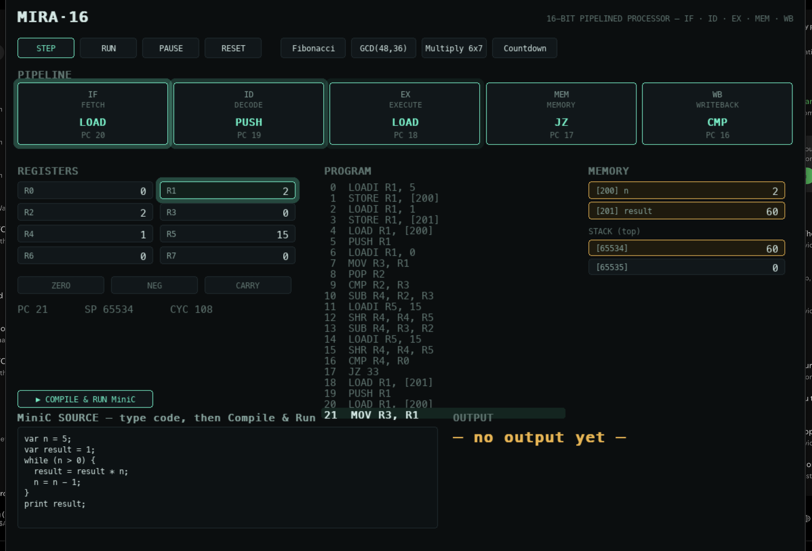

<div align="center">

# MIRA-16

**A 16-bit pipelined CPU, cache, and compiler — built from scratch in C++.**




**Live demo:** [Watch it run (YouTube)](https://youtu.be/hpwEXhHPkGI)

`25-instruction ISA` · `5-stage pipeline` · **7.26M** inst/s · `direct-mapped L1 cache` · **34** tests across **5** suites

</div>

---

## What it is

MIRA-16 is a complete computer implemented in software: a custom 16-bit instruction set, a 5-stage pipelined processor with hazard handling, a direct-mapped L1 cache, and a compiler for a small C-like language. Every layer feeds the one below it — high-level code is compiled to assembly, assembled to machine code, and executed cycle-by-cycle by the CPU. Nothing between layers is faked.

> The pipeline is verified against a simple scalar model by **differential testing** — the two must produce identical state on every test program. Compiled code runs on that scalar model (the authoritative functional core); the pipeline is a timing model demonstrated on hand-written benchmark programs.

## Highlights

- **Custom ISA** — 16-bit fixed-width, 25 instructions across three formats (register / immediate / jump).
- **5-stage pipeline** (IF · ID · EX · MEM · WB) with data forwarding, load-use interlock stalls, and branch flushing.
- **Direct-mapped L1 cache** with configurable miss penalty; reports hit rate and AMAT.
- **Compiler** for a C-like language ("MiniC") — hand-written lexer, recursive-descent parser, and code generator.
- **Verified** — 34 tests across 5 suites; pipeline differentially checked against the scalar reference; **7.26M instructions/sec** measured.

## How it works

```
MiniC source ──► compiler ──► assembly ──► assembler ──► machine code ──► CPU
 var n = 5;      lex→parse    LOADI R1,5    two-pass      16-bit words     scalar
 print n;        →codegen     OUT  R1       (labels)                       + pipeline
                                                                              │
                                                          cache ◄────────────┘
                                                     (in the MEM stage)
```

The scalar CPU is the reference model (what the result is); the pipeline is the timing model (how many cycles). The cache plugs into the pipeline's memory stage, affecting timing without changing results.

## Tech stack

**Core:** C++17 · Make
**Visualizer:** Python (pygame)
**Tooling:** Git · matplotlib (trace plots)

## Repository layout

```
include/     ISA, CPU, pipeline, cache, compiler, assembler headers
src/         implementations + CLI drivers (cpu, pipeline, cache, compiler, bench)
tests/       5 suites: scalar, pipeline (differential), cache, cache+pipeline, compiler
examples/    sample programs — MiniC (.mc) and assembly (.asm)
gui/         cpu_gui_pygame.py — interactive visualizer
tools/       trace_plot.py — execution charts
```

## Run it

Requires `g++` (C++17) and `make`.

```bash
make test-all      # build everything, run all 5 test suites
make run           # Fibonacci on the live terminal dashboard
make compiler      # compile & run a MiniC program (factorial → 120)
make bench         # throughput benchmark

python3 gui/cpu_gui_pygame.py   # interactive GUI (needs: pip install pygame)
```
